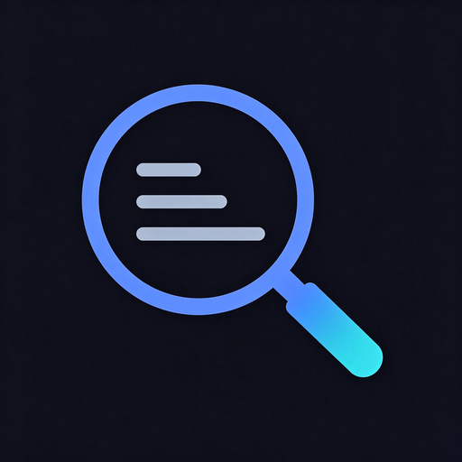
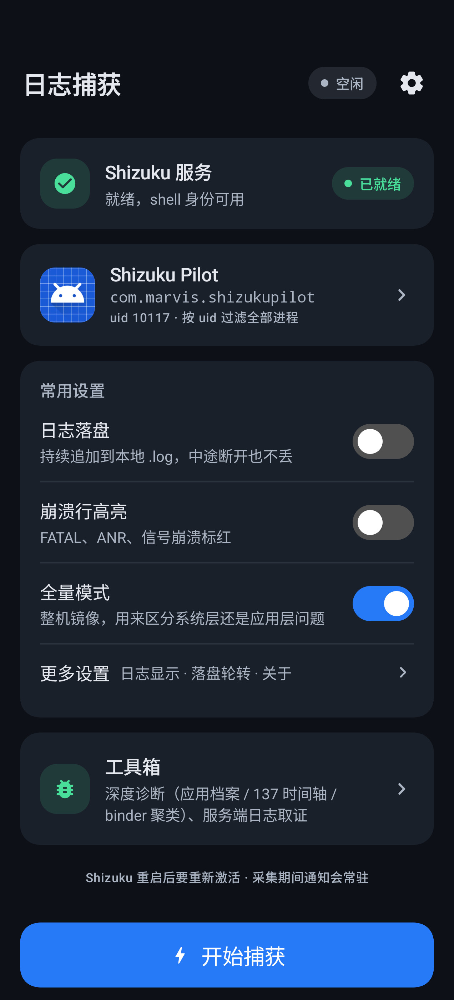
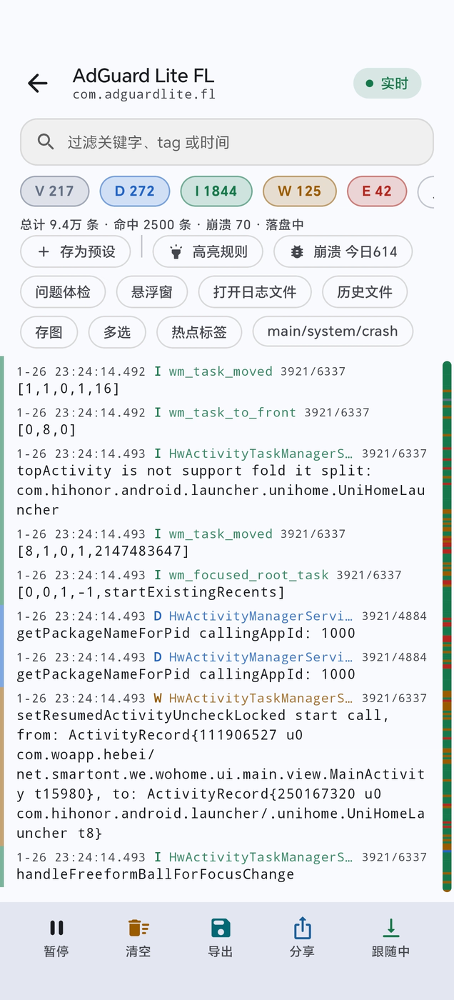
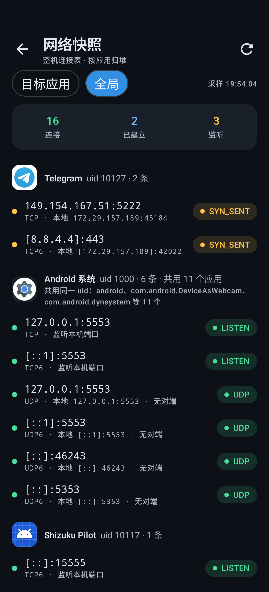

# LogLens · 日志透镜

装个 App，勾一个应用，就能在手机上实时看到**它自己的 logcat**——不用 root、不用刷机，装好之后日常看日志也不用连电脑。前置只有一件：Shizuku 先激活一次。激活本身同样不需要 root，但要看系统版本：Android 11+ 用开发者选项里的「无线调试」配对启动，全程不用电脑；Android 8–10 得借一台电脑走 USB ADB，手机已有 root 则直接在 Shizuku 里选 root 启动。

借 Shizuku 的 shell 身份（uid 2000）拉起 `logcat`，用 `--uid=<uid>` 按应用过滤——uid 过滤抓到的是这个 uid 下的**全部进程**（多进程、子进程一起覆盖），不是只盯某一个 pid；设备不认 `--uid` 时退化为全量输出 + 客户端按 pid 集合复核（pid 集合每 4 秒刷新，进程重启会自动接上，不需要重选）。崩溃、ANR、binder 报错、App 自己打进日志的私有目录操作，全在手机上，能落盘、能导出、能直接发给同事。

- 包名 `dev.loglens`｜Android 8.0+（minSdk 26）｜targetSdk 36｜release 包约 2.2 MB
- UI：Jetpack Compose + Miuix（HyperOS 观感，深色为主）
- 无联网权限，无统计 SDK，日志不出本机

<p align="center">
  <br>
  
  
  
  
</p>

## 和同类工具的区别

看懂一个第三方 App 为什么崩、为什么卡、为什么连不上网，现在只有三条路，每条都别扭：

- **电脑上 `adb logcat`**：得插线、得开会话、得记得 `--uid` 怎么写，出了问题往往人不在电脑前
- **手机上的 logcat 阅读器**：多数要 root（或要你自己开「日志记录器」权限），而且普遍是全量抓、看实现——你并不知道目标 App 的日志是哪个 tag
- **应用内的调试日志面板**：只能看自己写的 App，看不了别人的

LogLens 走的是第四条：Shizuku 已经把 shell 身份给你了（Android 11+ 走无线调试，8–10 走 USB ADB 或 root），缺的只是把「命令行能力」变成「选一个应用，点开始」。

| | 电脑 adb logcat | 手机 logcat 阅读器 | 应用内日志面板 | **LogLens** |
| --- | --- | --- | --- | --- |
| 需要电脑 | 要 | 不要 | 不要 | **不要** |
| 需要 root | 不要，但要 USB/无线调试 | 因 App 而异 | 不要 | **不要（Shizuku 即可）** |
| 按「目标应用」过滤 | 手写 `--uid` / `--pid` | 看实现 | 只能看自己 | **选应用即过滤，抓整族进程** |
| Android 16 常驻胶囊 / 灵动岛 | 无 | 无 | 无 | **有，且胶囊可暂停/继续** |
| 崩溃 / ANR 专门链路 | 自己翻 | 自己翻 | 无 | **崩溃归集 + 问题体检 + 九分区诊断** |
| 网络问题定位 | 另开抓包工具 | 无 | 无 | **按应用连接时间轴（不装 CA）** |
| 手机端导出分享 | 复制粘贴 | 有限 | 无 | **txt / csv / json / zip / 长图** |
| 体积 / 联网 | — | 数 MB 起 | — | **2.2 MB，零联网** |

> 表里的「不需要电脑」指**日常抓日志**：Shizuku 激活之后就不用连电脑了。激活本身分版本——Android 11+ 用无线调试，不需要电脑；Android 8–10 需要一台电脑走 USB ADB，手机已有 root 则不用电脑。

> 「手机 logcat 阅读器」「应用内日志面板」两列只按类别说、**不点名第三方 App**：同类工具不同版本、不同实现的能力差别很大（过滤、后台、暂停各不一样），点名做对比既容易过时，也不够公道，所以这里也不做「多数如何」的断言。能确定点名的只有三样：`adb logcat`（电脑端命令行）、Android Studio 的 Logcat 窗口（只能看正在调试的那个进程）、[Shizuku](https://shizuku.rikka.app/)（它只给 shell 身份，本身不带界面）。LogLens 补的正是最后这一层。

真正把我们和别人分开的，是下面五件组合起来的事。

### 1. 以「应用」为维度，而不是 tag

普通阅读器给你的是"整个系统的日志洪流"，你得自己筛。LogLens 直接拿目标应用的 uid 去抓，抓到的就是这个应用进程族自己写进日志的东西——包括它的子进程、它在日志里打出来的私有目录操作、它的 binder 调用失败。不用知道它的 tag 叫什么，也不用背 `--uid`。

> 一句边界话：`logcat` 看到的是「App 自己写进日志的内容」，不是内核视角。文件级的读写 syscall 它抓不到（那要走 inotify / strace）。私有目录**整段**（内部 `files/`、`cache/`）能看，是深度诊断里走 `run-as` 读的，前提是目标 App 是 debuggable。

### 2. 常驻胶囊就是主控台，而且状态是真的

采集是一个 `specialUse` 前台服务，通知从 Android 16 起申请 Promoted Ongoing（各家 ROM 的常驻胶囊 / 灵动胶囊）。胶囊上直接显示采集时长、已捕获条数、崩溃数，暂停/继续按钮也在胶囊上。

关键是**胶囊状态和采集状态是同一份状态**：点暂停，logcat 真的断流；点继续，按原参数重新拉起并重新上岛；点停止，撤通知、撤胶囊、结束服务，不留残影。很多同类工具按下"暂停"只是让列表别滚了，后台还在抓——那在你的场景里等于什么都没停。

### 3. 崩了、卡了，有专门的链路，不用你在几万行里翻

- **崩溃归集**：以崩溃为线索把相关行收拢成一组，堆栈自动折叠
- **问题体检**：把常见病因（权限、137 退出、binder 死、通道受限）直接点名
- **深度诊断（十个分区）**：应用档案、进程是否生效、137 退出、ANR、events、native crash、dropbox 崩溃存档、binder、私有目录、全量 logcat
- **取证包**：服务落盘日志的路径与 tag、四步流水、结论三态（已命中问题特征 / 待核 / 本次未命中）、FileProvider 产物——最后给你一个能发给别人的包，而不是一堆原始行；不知道日志文件叫什么，进页面点一下就能列目录选

### 4. 网络问题也有自己的页，而且不用装 CA

很多"连不上"其实是连接建不起来。网络快照按 1.4 秒一轮采样，画出一条时间轴：存活 / 已建立 / 监听 / SYN_SENT 卡住 / 已消失 五格统计，按应用分组，已消失的连接保留 90 秒留痕。**SYN_SENT 超过 3 秒直接判为连接失败**——这个判断比抓包更快，也不需要 VpnService 和自签 CA（那条路必然被 pinning 挡）。

### 5. 抓完就能发走

导出 txt / csv / json / zip，或者把当前列表存成长图；落盘文件可一键复制到 `Download`。给同事、贴 issue、写周报，都不用在手机上长按复制。

## 功能清单

| 模块 | 能力 |
| --- | --- |
| 首页 | Shizuku 六种状态识别与授权引导、目标应用按 uid 选择、落盘开关、崩溃高亮、全量 / 单应用模式、一键开始捕获 |
| 日志页 | 关键字 / 正则搜索、tag 包含与排除、只看崩溃、书签、级别计数、折叠堆栈、折叠刷屏、markText 高亮、紧凑行、小地图、暂停跟随、悬浮窗、离线导入、日志通道受限引导、崩溃归集、问题体检 |
| 网络快照 | 目标应用或整机；时间轴录制；五格统计；按应用分组；SYN_SENT > 3s 判连接失败；已消失连接保留 90s |
| 工具箱 | 深度诊断、取证包、网络快照、问题反馈（导出 LogLens 自己的运行日志） |
| 深度诊断 | 十个分区：应用档案 / 进程是否生效 / 137 退出 / ANR / events / native crash / dropbox 崩溃存档 / binder / 私有目录 / 全量 logcat |
| 取证包 | 读服务自己写的日志文件 + 按 tag 拉 logcat 尾部，走「探测 → 关键句抽取 → 尾部导出 → 分享」，给出结论三态（已命中问题特征 / 待核 / 本次未命中）；不确定文件在哪可一键列目录选文件 |
| 设置 | 采集行为、日志显示（字号 9–20 / 最大行数 / 小地图 / 常亮）、存储（单文件上限 / 保留份数）、关于 |

## 安装

1. 先装 [Shizuku](https://shizuku.rikka.app/) 并启动服务，按系统版本选一条路：
   - **Android 11+**：开发者选项 → 打开「无线调试」→ 在 Shizuku 里按引导配对启动，全程不需要电脑
   - **Android 8–10**：用 USB 连电脑，按 Shizuku「通过 ADB 启动」页给出的命令执行（页面里可直接复制）；手机已有 root 则直接在 Shizuku 里选 root 启动
2. 装 LogLens：从 [Releases](../../releases) 下载 APK，或自己构建
3. 打开 LogLens，按首页引导在 Shizuku 里给它授权
4. 选目标应用 → 点开始捕获 → 回桌面看胶囊，或留在日志页看日志

> Shizuku 用 root 启动（`su`）也能用，那种情况下它的 server 是 uid 0，转给 App 的命令就是 root 权限。LogLens 不利用这一点：它只请求 shell 身份、只发 `logcat`、`dumpsys package`、`pidof`、读 `/proc` 这几类命令，shell 干得动就够，root 换不来新功能，反而等于把 root 借给所有获授权的 App。所以「必须 root」不是本工具的要求；有 root 就把 Shizuku root 起，只是省得重新连电脑。

> 这是个人自用工具，侧载安装，不上架应用商店。release 走 R8 混淆，崩溃堆栈用构建时生成的 `mapping.txt` 还原。

## 构建

需要 JDK 17 或更高（本仓库实际用 JDK 21 构建）、Android SDK（compileSdk 37 平台）。

**Android Studio**：`File → Open` 选仓库根目录，等 Gradle 同步完，运行配置选 `app` 直接跑。SDK 路径由 Studio 写进 `local.properties`（已在 `.gitignore` 排除），不用手工填。

**命令行**：先让 `ANDROID_HOME` 指向 SDK（或同样写 `local.properties` 的 `sdk.dir`），然后

```bash
./gradlew assembleDebug      # macOS / Linux
gradlew.bat assembleDebug    # Windows
# 产物：app/build/outputs/apk/debug/app-debug.apk
```

依赖是做了校验的：`gradle/verification-metadata.xml` 里记着每个构件的 SHA-256，下载到的包对不上会直接报 `Dependency verification failed` 并把差的那几个列出来。正常开发不用管；**只有加/升依赖时才需要**重新生成：

```bash
./gradlew --write-verification-metadata sha256 --refresh-dependencies assembleDebug
```

生成完把 `gradle/verification-metadata.xml` 的 diff 一起提交，审查的人就能看到这次动了哪些构件。

release 默认开 R8。要出可安装的 release 包，在仓库根目录放 `keystore.properties`（已在 `.gitignore` 排除）：

```properties
storeFile=/abs/path/to/release.jks
storePassword=******
keyAlias=release
keyPassword=******
```

`keyAlias` 只是示例名，填你签名时用的那个 alias 就行（本仓库自用的是 `loglens`）。放好后 `./gradlew assembleRelease` 会自动接上签名；没有这个文件时只产出未签名包。

## 已知限制

- 必须有 Shizuku 在跑；Shizuku 被系统杀掉、**或手机重启之后**，采集会断流，要重新激活一次：Android 11+ 走无线调试，Android 8–10 重新连电脑走 USB ADB（root 或常驻 adb 环境除外）。这是 Shizuku 非 root 模式的固有前提，不是本工具的门槛
- 部分 ROM（荣耀 / 华为）默认关掉 AP 日志，需要拨号盘工程码打开，App 内会给出引导
- 深度诊断里「应用私有目录」的内部 `files/`、`cache/` 要靠 `run-as` 读，目标 App 不是 debuggable 时只能看到 `/sdcard/Android/data/<pkg>` 那一层
- 崩溃存档读的是系统 dropbox（`dumpsys dropbox --print`），能拿到 Java 崩溃、native 崩溃、ANR 的文本存档，**不需要 root**，logcat 滚掉之后仍然在。但原文不在这一层：`/data/anr`、`/data/tombstones`、`/data/system/procexitstore/*.gz` 这三处 shell 直接读都被拒（实测 Permission denied，走 `ApplicationExitInfo.getTraceInputStream()` 也只对进程自己的 uid 放行，shell 拿到的是 null）。要原文只有两条路：`bugreport`——dumpstate 以 root 身份收集，zip 里直接带 `FS/data/anr/*` 与 `FS/data/tombstones/*`；或者 root。
- 不做完整抓包：VpnService + 自签 CA 必然撞 pinning，所以网络页只做连接快照
- 暂停期间不抓日志，这段不会补回来——暂停就是"先不看了"；页面上的"暂停跟随"是另一件事，只控制列表滚不滚

## 出问题了怎么反馈

采集拉不起来、悬浮窗不出现、或者 LogLens 自己崩了——先打开 **工具箱 → 问题反馈**。那一页会把 LogLens 自己的运行日志摊开：启动、Shizuku 授权结果、采集启停参数、日志流退出码、落盘失败、通道被系统限制、自身崩溃现场。可以一键复制，也可以导成 txt 分享。

这份日志只写在本机 `files/self_log/loglens.log`（最多 2 份 × 512 KB，自动滚动），不抄被采集应用的日志内容，不联网。把「你做了什么 + 看到什么」和这段日志一起贴到 [Issues](../../issues) 就行。

## 隐私

所有日志只留在本机：内存环形缓冲 + `Android/data/dev.loglens/files/` 下的落盘与导出文件。App 不申请联网权限，不上传任何数据，也没有统计 SDK。

App 自己的运行日志（`files/self_log/`）同理，只在本机、只记 LogLens 自己的动作；要不要发给作者由你在「问题反馈」页里手动决定。

App 内还提供了一份逐条摊开的说明：**设置 → 关于 → 隐私说明**，把实际申请的每一项敏感权限（应用列表、可选的「使用情况访问」、悬浮窗、落盘）都写清楚读什么、写到哪、不读什么，不用去翻网页。


## 安全与信任

这个 App 拿着 Shizuku 的 shell 级权限，所以「你装的是不是我以为的那个包」值得多说两句。

**只从 Releases 下。** 群文件、网盘、别人转的 APK 都不是本仓库产出的；有人会二次打包换图标再分发，装上去依然叫 LogLens。

**装之前核对两件事**：Release 里随附的 `LogLens-x.y.z.apk.sha256` 要和文件对得上；签名证书指纹必须是 `1C:75:ED:15:BB:CB:B1:D4:44:CF:E6:7C:23:65:0C:6A:CA:B7:75:E8:13:8B:04:35:A6:DE:6C:18:BE:DF:C6:AC`（`apksigner verify --print-certs` 就能看）。指纹变了就是另一个包，和 1.2.4 没法互相覆盖升级。

**这个 App 免费，也不会收费。** 如果有人换了图标、改个名字，放到应用商店、群文件或网盘让你付费下载，那不是我发的：**不要付款**，把链接或截图发给作者——[新建一个 Issue](https://github.com/1764364648/loglens/issues/new/choose)（模板选「报告一个问题」，标题写清是换皮收费）或按 [SECURITY.md](SECURITY.md) 走私下报告。源码是 GPL-3.0，允许别人修改和再分发（包括收钱卖），但必须一并提供完整源码、保留同一份许可；改名换皮不改变来源，更不代表我背书。

**依赖和构建也做了校验。** 每个构件的 SHA-256 都钉在 `gradle/verification-metadata.xml` 里，任一镜像返回被替换的构件，构建直接中断；CI 只跑验证（编译、60 条单测、lint），不产包。PR 闸门、分支保护与漏洞报告细节见 [SECURITY.md](SECURITY.md)。

## 许可

[GNU General Public License v3.0](LICENSE)（GPL-3.0-only）。

- 免费使用、修改、分发，商业使用也允许
- 但分发原版或改过的版本时，必须一并提供完整源码、保留同一份许可、不得追加额外限制
- 也就是说：想改个皮、换套名字拿去闭源卖，得把自己的改动也开源出来，下游还能合法免费再分发

Copyright (C) 2026 LogLens。作为唯一版权人，作者保留另行授权（dual licensing）的权利。

## 致谢

[Shizuku](https://github.com/RikkaApps/Shizuku)（RikkaApps）提供 shell 通道；[Miuix](https://github.com/compose-miuix-ui/miuix) 提供 HyperOS 风格组件。


