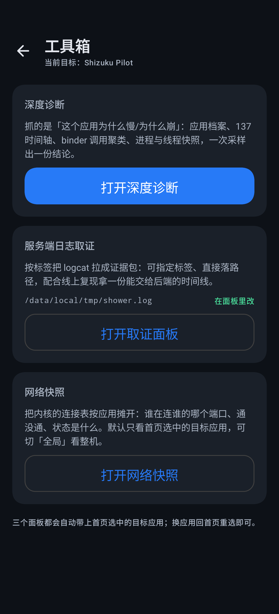

# LogLens · 日志透镜

装个 App，勾一个应用，就能在手机上实时看到**它自己的 logcat**——不用连线到电脑，不用 root，不用刷机。

借 Shizuku 的 shell 身份（uid 2000）拉起 `logcat`，用 `--uid=<uid>`（失败降级 `--pid`）只抓目标进程的日志；崩溃、ANR、binder 报错、私有目录写入，全在手机上，能落盘、能导出、能直接发给同事。

- 包名 `dev.loglens`｜Android 8.0+（minSdk 26）｜targetSdk 36｜release 包约 2.2 MB
- UI：Jetpack Compose + Miuix（HyperOS 观感，深色为主）
- 无联网权限，无统计 SDK，日志不出本机

<p align="center">
  <br>
  
  
  
</p>

## 和同类工具的区别

看懂一个第三方 App 为什么崩、为什么卡、为什么连不上网，现在只有三条路，每条都别扭：

- **电脑上 `adb logcat`**：得插线、得开会话、得记得 `--uid` 怎么写，出了问题往往人不在电脑前
- **手机上的 logcat 阅读器**：多数要 root（或要你自己开「日志记录器」权限），而且普遍是全量抓、靠 tag 猜——你并不知道目标 App 的日志是哪个 tag
- **应用内的调试日志面板**：只能看自己写的 App，看不了别人的

LogLens 走的是第四条：Shizuku 已经用无线调试给你 shell 身份了，缺的只是把「命令行能力」变成「选一个应用，点开始」。

| | 电脑 adb logcat | 手机 logcat 阅读器 | 应用内日志面板 | **LogLens** |
| --- | --- | --- | --- | --- |
| 需要电脑 | 要 | 不要 | 不要 | **不要** |
| 需要 root | 不要，但要 USB/无线调试 | 多数要 | 不要 | **不要（Shizuku 即可）** |
| 按「目标应用」过滤 | 手写 `--uid` / `--pid` | 靠 tag 猜 | 只能看自己 | **选应用即过滤，抓整族进程** |
| Android 16 常驻胶囊 / 灵动岛 | 无 | 无 | 无 | **有，且胶囊可暂停/继续** |
| 暂停是否真停采集 | 你自己 Ctrl+C | 多数只是停渲染 | — | **真空转：logcat 断流** |
| 崩溃 / ANR 专门链路 | 自己翻 | 自己翻 | 无 | **崩溃归集 + 问题体检 + 九分区诊断** |
| 网络问题定位 | 另开抓包工具 | 无 | 无 | **按应用连接时间轴（不装 CA）** |
| 手机端导出分享 | 复制粘贴 | 有限 | 无 | **txt / csv / json / zip / 长图** |
| 体积 / 联网 | — | 数 MB 起 | — | **2.2 MB，零联网** |

真正把我们和别人分开的，是下面五件组合起来的事。

### 1. 以「应用」为维度，而不是 tag

普通阅读器给你的是"整个系统的日志洪流"，你得自己筛。LogLens 直接拿目标应用的 uid 去抓，抓到的就是这个应用进程族自己产生的一切——包括它的子进程、它的私有目录读写、它的 binder 调用失败。不用知道它的 tag 叫什么，也不用背 `--uid`。

### 2. 常驻胶囊就是主控台，而且状态是真的

采集是一个 `specialUse` 前台服务，通知从 Android 16 起申请 Promoted Ongoing（各家 ROM 的常驻胶囊 / 灵动胶囊）。胶囊上直接显示采集时长、已捕获条数、崩溃数，暂停/继续按钮也在胶囊上。

关键是**胶囊状态和采集状态是同一份状态**：点暂停，logcat 真的断流；点继续，按原参数重新拉起并重新上岛；点停止，撤通知、撤胶囊、结束服务，不留残影。很多同类工具按下"暂停"只是让列表别滚了，后台还在抓——那在你的场景里等于什么都没停。

### 3. 崩了、卡了，有专门的链路，不用你在几万行里翻

- **崩溃归集**：以崩溃为线索把相关行收拢成一组，堆栈自动折叠
- **问题体检**：把常见病因（权限、137 退出、binder 死、通道受限）直接点名
- **深度诊断（九个分区）**：应用档案、进程是否生效、137 退出、ANR、events、native crash、binder、私有目录、全量 logcat
- **取证面板**：落盘路径与 tag、复制到 Download、四步流水、结论三态、FileProvider 产物——最后给你一个能发给别人的包，而不是一堆原始行

### 4. 网络问题也有自己的页，而且不用装 CA

很多"连不上"其实是连接建不起来。网络快照按 1.4 秒一轮采样，画出一条时间轴：存活 / 已建立 / 监听 / SYN_SENT 卡住 / 已消失 五格统计，按应用分组，已消失的连接保留 90 秒留痕。**SYN_SENT 超过 3 秒直接判为连接失败**——这个判断比抓包更快，也不需要 VpnService 和自签 CA（那条路必然被 pinning 挡）。

### 5. 抓完就能发走

导出 txt / csv / json / zip，或者把当前列表存成长图；落盘文件可一键复制到 `Download`。给同事、贴 issue、写周报，都不用在手机上长按复制。

## 功能清单

| 模块 | 能力 |
| --- | --- |
| 首页 | Shizuku 六种状态识别与授权引导、目标应用按 uid 选择、落盘开关、崩溃高亮、全量 / 单应用模式、一键开始捕获 |
| 日志页 | 关键字 / 正则搜索、tag 包含与排除、只看崩溃、书签、级别计数、折叠堆栈、折叠刷屏、markText 高亮、紧凑行、小地图、暂停跟随、悬浮窗、离线导入、日志通道受限引导、崩溃归集、问题体检 |
| 网络快照 | 目标应用或整机；时间轴录制；五格统计；按应用分组；SYN_SENT > 3s 判连接失败；已消失连接保留 90s |
| 工具箱 | 深度诊断、取证包、网络快照入口 |
| 深度诊断 | 九个分区：应用档案 / 进程是否生效 / 137 退出 / ANR / events / native crash / binder / 私有目录 / 全量 logcat |
| 取证包 | 读服务自己写的日志文件 + 按 tag 拉 logcat 尾部，走「探测 → 关键句抽取 → 尾部导出 → 分享」，给出结论三态；不确定文件在哪可一键列目录选文件 |
| 设置 | 采集行为、日志显示（字号 9–20 / 最大行数 / 小地图 / 常亮）、存储（单文件上限 / 保留份数）、关于 |

## 安装

1. 先装 [Shizuku](https://shizuku.rikka.app/) 并用无线调试方式启动服务
2. 装 LogLens：从 [Releases](../../releases) 下载 APK，或自己构建
3. 打开 LogLens，按首页引导在 Shizuku 里给它授权
4. 选目标应用 → 点开始捕获 → 回桌面看胶囊，或留在日志页看日志

> 这是个人自用工具，侧载安装，不上架应用商店。release 走 R8 混淆，崩溃堆栈用构建时生成的 `mapping.txt` 还原。

## 构建

需要 JDK 17、Android SDK（compileSdk 37 平台）。

```bash
./gradlew assembleDebug
# 产物：app/build/outputs/apk/debug/app-debug.apk
```

release 默认开 R8。要出可安装的 release 包，在仓库根目录放 `keystore.properties`（已在 `.gitignore` 排除）：

```properties
storeFile=/abs/path/to/release.jks
storePassword=******
keyAlias=release
keyPassword=******
```

放好后 `./gradlew assembleRelease` 会自动接上签名；没有这个文件时只产出未签名包。

## 已知限制

- 必须有 Shizuku 在跑；Shizuku 被系统杀掉后采集会断流
- 部分 ROM（荣耀 / 华为）默认关掉 AP 日志，需要拨号盘工程码打开，App 内会给出引导
- 不做完整抓包：VpnService + 自签 CA 必然撞 pinning，所以网络页只做连接快照
- 暂停期间不抓日志，这段不会补回来——暂停就是"先不看了"；页面上的"暂停跟随"是另一件事，只控制列表滚不滚

## 隐私

所有日志只留在本机：内存环形缓冲 + `Android/data/dev.loglens/files/` 下的落盘与导出文件。App 不申请联网权限，不上传任何数据，也没有统计 SDK。

App 内还提供了一份逐条摊开的说明：**设置 → 关于 → 隐私说明**，把实际申请的每一项敏感权限（应用列表、可选的「使用情况访问」、悬浮窗、落盘）都写清楚读什么、写到哪、不读什么，不用去翻网页。


## 许可

[GNU General Public License v3.0](LICENSE)（GPL-3.0-only）。

- 免费使用、修改、分发，商业使用也允许
- 但分发原版或改过的版本时，必须一并提供完整源码、保留同一份许可、不得追加额外限制
- 也就是说：想改个皮、换套名字拿去闭源卖，得把自己的改动也开源出来，下游还能合法免费再分发

Copyright (C) 2026 LogLens。作为唯一版权人，作者保留另行授权（dual licensing）的权利。

## 致谢

[Shizuku](https://github.com/RikkaApps/Shizuku)（RikkaApps）提供 shell 通道；[Miuix](https://github.com/compose-miuix-ui/miuix) 提供 HyperOS 风格组件。
